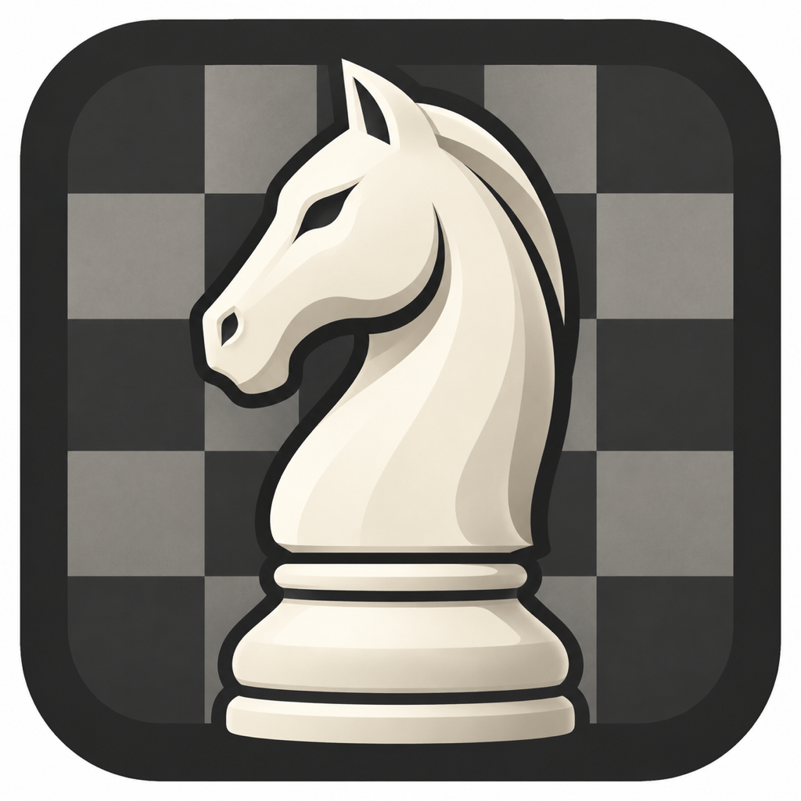
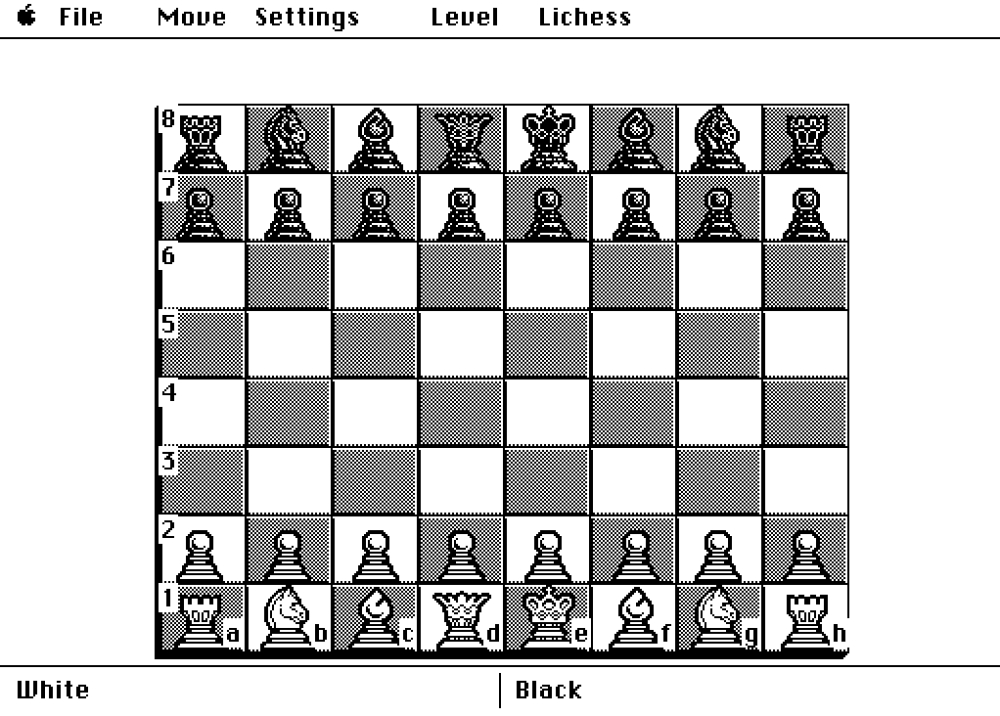

<p align="center"></p>

# BattleChess

Unofficial C/C++ recompilation of Battle Chess for Macintosh (1991), originally written for Motorola 68k processors. Runs natively on modern macOS and Linux/Unix using SDL3. Original game data must be supplied separately.

The C11 core translates recovered Macintosh move rules, opening-book traversal, evaluation, search, save format, and animation logic. The C++17 host replaces the Macintosh Toolbox with SDL3 and native file dialogs. This is a reverse-engineering project, not a clean-room implementation or an official release.

Implemented features include human/computer play, perspective and flat boards, movement and combat animations, promotion, board setup, save/load, move suggestions, and POSIX serial play, plus native extensions: PGN import/export, animated GIF export, adjustable animation speed, both boards side by side with a status and move-list panel, click-to-open menus, sharp whole-pixel scaling with full screen, optional bishop idle animations, and online play and analysis on Lichess. Full original-game parity remains incomplete: original save/modem interoperability, and complete animation, audio, and computer-play comparisons still need verification.

## Screenshots

Captured from the native SDL application using an external game-data pack. These are application captures, not mockups; they depict original game artwork, which is outside the MIT license.

| Perspective board | Flat board |
|---|---|
|  |  |


## Documentation

- [Build on macOS and Linux](docs/BUILD.md): dependencies, core/app builds, release builds and troubleshooting.
- [Code style](docs/CODE_STYLE.md): naming, filenames, namespace indentation and formatting commands.
- [Roadmap and feature coverage](docs/ROADMAP.md): implemented features, validation results and remaining recovery work.
- [External game data](docs/DATA.md): required pack files and the boundary between source and original resources.
- [BattleChess-re-tools](https://github.com/myaumura/BattleChess-re-tools): the public reverse-engineering tools; [prepare data](https://github.com/myaumura/BattleChess-re-tools/blob/main/docs/PREPARE_DATA.md) and [follow the recovery process](https://github.com/myaumura/BattleChess-re-tools/blob/main/docs/WORKFLOW.md).

## Build the core

Requires a C11/C++17 compiler and CMake 3.20+. No original files, SDL, or Python are needed for the default build.

```sh
./tools/build.sh
```

The script selects a core-only Debug build, compiles it, and runs the core tests, even after an earlier app build. To enable AddressSanitizer and UndefinedBehaviorSanitizer:

```sh
./tools/build.sh -DBC_SANITIZE=ON
```

## Build and run the game

The application additionally requires SDL3 3.4+ development files and an external prepared data pack. Original binaries, disk images, graphics, audio, fonts, and generated resource tables are excluded from this repository. Prepare the pack with [BattleChess-re-tools](https://github.com/myaumura/BattleChess-re-tools/blob/main/docs/PREPARE_DATA.md); see [the data contract](docs/DATA.md) for the required result.

See [macOS and Linux build instructions](docs/BUILD.md) for dependency installation, custom SDL paths, release builds, and troubleshooting. These scripts do not download dependencies or game data.

```sh
export BC_DATA_DIR=/absolute/path/to/prepared-data
./tools/build.sh -DBC_BUILD_APP=ON -DBC_DATA_DIR="$BC_DATA_DIR"
./tools/run.sh
```

Both scripts work from any directory. `run.sh` configures and builds the app before launching it, so changing the data pack also rebuilds its compiled catalogs. All tests in this repository are C/C++; Python is not required.

Direct CMake use:

```sh
cmake -S . -B build -DBC_BUILD_APP=ON -DBC_DATA_DIR="$BC_DATA_DIR"
cmake --build build --parallel
ctest --test-dir build --output-on-failure
./build/battlechess --data "$BC_DATA_DIR"
```

Add `-DCMAKE_PREFIX_PATH=/path/to/sdl3` when SDL is installed outside CMake's search path. Direct CMake commands retain cached options; `tools/build.sh` selects the core by default, and an explicit `-DBC_BUILD_APP=ON` enables the application.

## Controls

Click a piece, then its destination. Menus open with a click and stay open until you click an item, click elsewhere or press Escape; the original press-drag-release selection also works. The menus provide new game, open/save, take back, replay, board setup, move suggestions, and player/view settings. Human White and Mac Black are the initial modes. Promotion presents the recovered piece choices after the pawn moves. When a game ends (checkmate, stalemate, the computer resigning, or a Lichess result), the final position stays on the board for Take Back, Export PGN and Export GIF until you choose New Game; the original game cleared the board after the ending message, which modem games still do so both machines stay in step.

Command/Ctrl+N, O, S, B, R, and Q access the corresponding menu actions. Command/Ctrl+F forces a computer move; Command/Ctrl+M suggests a move. File → Export PGN... (Command/Ctrl+E) writes the moves played since the last New Game, Open or board setup as a PGN file; positions that do not start from the standard setup get a FEN tag. File → Import PGN... (Command/Ctrl+I) loads the first game of a PGN file at its final position; Take Back and Replay step through its moves, and comments, variations and annotations are skipped. File → Export GIF... (Command/Ctrl+G) records the game's movement, combat, capture and checkmate animations at twice the original speed as an animated GIF at double size, always on the 3D board whichever view is shown; a progress dialog shows the move being recorded, and the window accepts no input until the export finishes. Escape dismisses a menu or selection. `--flat` starts with the flat board, `--both` starts with both boards side by side, and `--serial DEVICE` connects a POSIX serial device. `--help` lists application options.

Settings → Animation Speed opens a submenu with 1x (original timing), 1.25x, 1.5x, 1.75x, and 2x for movement, combat, and capture fades. Hover or click Animation Speed, then click (or release) over a speed to select it. The selected speed lasts for the current application session and is independent of the computer's thinking time.

Settings → Show Both Boards shows the 3D board on the left and the 2D board on the right; moves can be entered on either. A panel underneath shows whose turn it is, check and mate, the players and the computer level, and the game's moves; the latest move is highlighted, moves you can Replay are gray, and clicking a move jumps to the position after it. Animations play on the 3D board while the 2D board shows the position before the move, then catches up. Set Up Board uses the single 2D board and returns to both boards when done. Turning the option off restores the board view chosen before.

Settings → Enter Full Screen (F11 or Control-Command-F) fills the display. The game is always scaled by whole pixels so the 1-bit artwork stays sharp; a window smaller than the game falls back to smooth scaling.

Settings → Idle Animations (off by default) lets a bishop fidget on the 3D board when the board has been quiet for 10 to 25 seconds on a human's turn; any click or key stops it. The clips are the game's own recovered bishop animations, but the original Macintosh release never plays them (see the [roadmap](docs/ROADMAP.md#idle-animations-in-the-macintosh-release)), so the trigger and timing are this port's invention.

## Play on Lichess

The **Lichess** menu (in the Modem slot when no serial device is connected) plays casual games on [lichess.org](https://lichess.org) through its Board API, with the opponent's moves shown through the game's own animations.

- **Connect...** opens Lichess's token page with the needed scopes already ticked (`board:play`, `challenge:read`, `challenge:write`). Create the token there, paste it into the prompt (Command/Ctrl+V) and press OK. On macOS the token is kept in the login Keychain; on other systems it lasts for the session, or set `BC_LICHESS_TOKEN` before starting. **Forget Lichess Token** removes it. The token is only ever sent to Lichess, as an `Authorization` header.
- **Analyse Game on Lichess** uploads the current game's PGN and opens Lichess's analysis board; no account is needed. After an online game it opens that game's page instead.
- **Play Lichess AI** plays the Lichess computer at the strength chosen in the Level menu (Novice and Level 1 = AI level 1, up to Level 8 and 9 = AI level 8). **Challenge Player...** challenges a user by name; **Find Opponent** posts a public seek (Lichess allows rapid, classical and correspondence seeks only); choose the same item again to cancel. **Time** cycles through 10+0, 15+10, 30+0, 30+20, 5+3 (blitz: AI and challenges only) and 3-day correspondence. You play White or Black when Settings has exactly one human side, otherwise the colour is random.
- **Games...** opens the Lichess lobby, which also appears by itself after connecting when games are running, and when someone challenges you. It lists incoming challenges and your games in progress (opponent, speed, whose move, time left), most urgent first. **Open** (or a double-click, or Return) plays the selected game here; **Accept** and **Decline** answer a challenge; bullet games, which the Board API cannot play, open on lichess.org instead. Below the list, **Time** sets the time control and **Play AI**, **Challenge...** and **Find Opponent** start a new game. Escape or **Close** returns to the board.
- **Playing a friend:** in the lobby (or the Lichess menu) choose **Challenge...** and enter your friend's Lichess username. Your friend accepts on lichess.org or in the Lichess app (or in Battle Chess, if they are connected too); the game then opens on your board. While the challenge waits, the button reads **Cancel Ch.** (menu: **Cancel Challenge**).
- **Leave Game** stops showing the online game without resigning: it continues on Lichess with your clock running, and you can reopen it from the lobby. To start a local game during an online one, leave (or finish) it first, then use File > New Game.
- Draw offers appear as Accept/Cancel alerts. **Offer Draw** and **Resign** (or **Abort Game** before both sides have moved) act on the running game; the result appears when Lichess ends the game.
- During a game both clocks run in the menu bar (correspondence games show whose move it is), the side panel (with Show Both Boards) shows the players and whose move it is, and the board accepts moves only on your turn. A finished game stays on the board as it ended; after Leave Game or Disconnect the board is yours again. Suggest Move, Force Move, Take Back, Replay, New Game, player settings and levels are disabled: the recovered engine never moves or advises for your account.
- **Animations** sets how much clock time the animations may take. *Auto* (default) plays them fully in classical and correspondence games; in rapid, quiet moves play at 2x and captures appear at once; in blitz, or with under a minute on your own clock, moves appear at once. *Full*, *Fast* (2x, captures at once) and *Board Only* fix one style. A click during an animation finishes it immediately, and with both boards shown the 2D board shows the new position at once, so you can think and move there.

Not yet supported: playing from Black's side of the board (the view stays White's), chat, takebacks and claiming a win when the opponent leaves. All games are casual.

## Layout

```text
config/    Build and formatting configuration
lib/       C engine and C++ presentation code
src/       SDL application and native platform adapters
resources/ App icon and native-game screenshots
tests/     C/C++ core and integration checks
tools/     Build and run scripts only
docs/      Build instructions, code style, roadmap and external data requirements
```

Functions retain original addresses and recovery explanations where known. Native adapters are identified separately. Decompiler exports, Ghidra projects, recovery scripts, and evidence captures belong to the reverse-engineering workspace.

A successful build or native test does not establish equivalence to the original Macintosh executable.

## License

Project contributions use the [MIT license](LICENSE). The project is unofficial and is not affiliated with or endorsed by the original rights holders. Original game and third-party material are outside that license; see [NOTICE](NOTICE).
