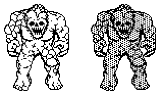
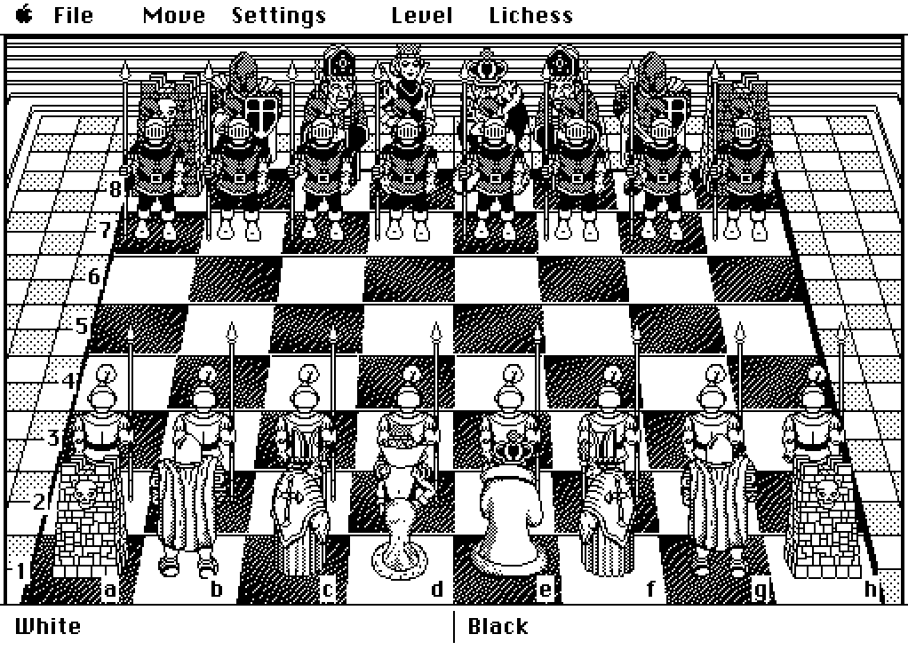
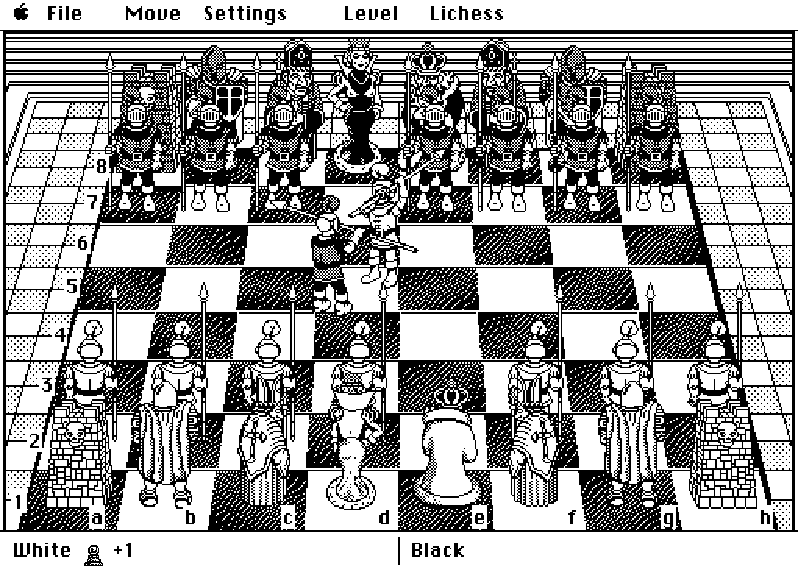
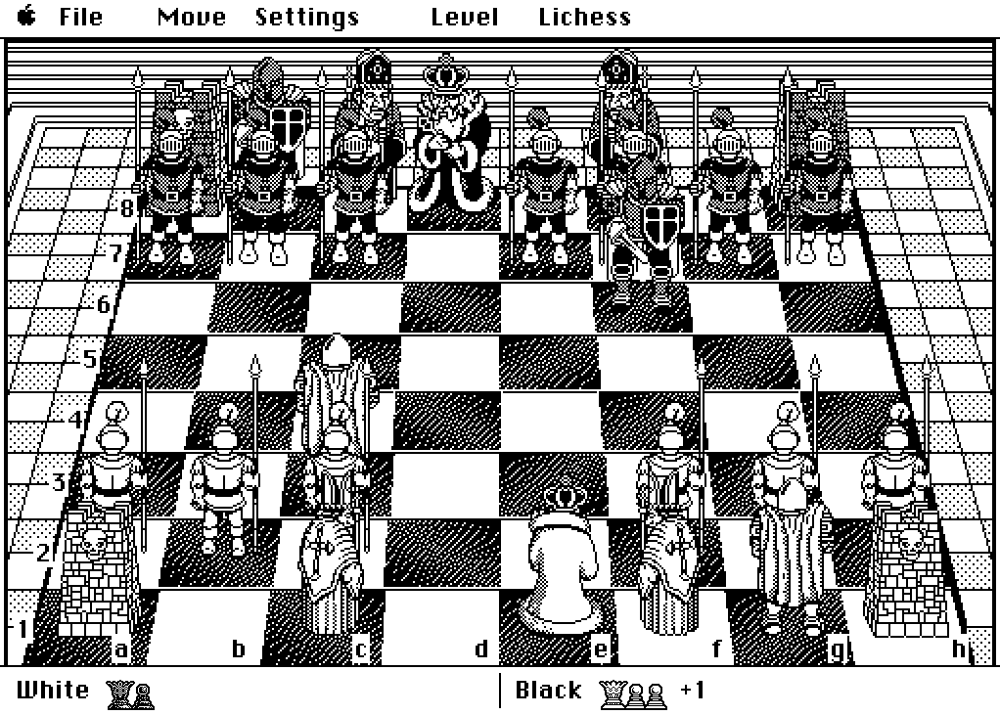
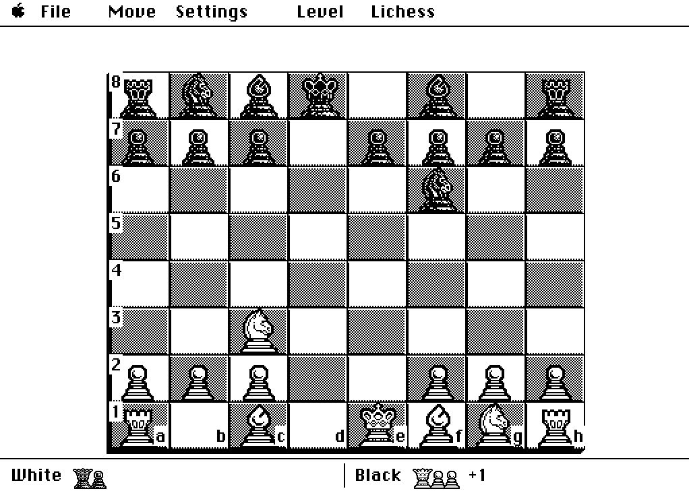
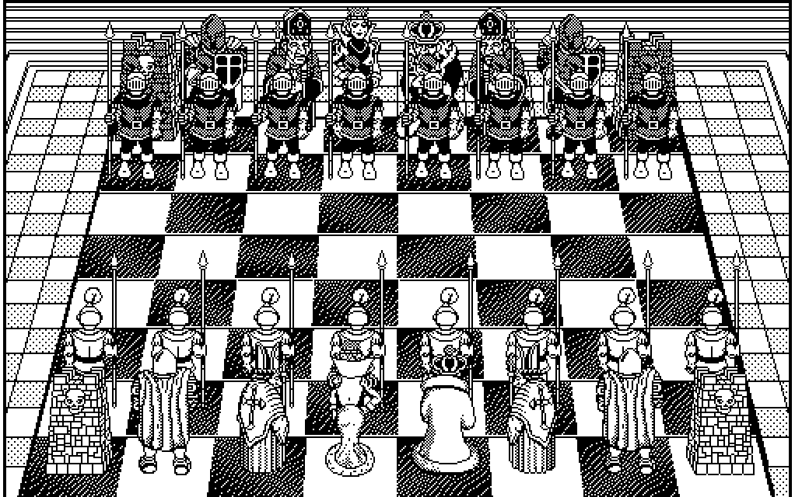

<p align="center"></p>

# BattleChess

<p align="center"></p>

An unofficial native recompilation of **Battle Chess for the Macintosh (1991)**, the black-and-white game whose pieces fight each other on capture. The original Motorola 68k program was reverse-engineered; its rules, opening book, computer player, save format and animations run again as C11 code, hosted by a C++17/SDL3 application on modern macOS and Linux. Original game data is supplied separately.

This repository is a fork of Kirill Gusev's port ([myaumura/BattleChess](https://github.com/myaumura/BattleChess)). It keeps the recovered game intact and adds **online play on Lichess**, both boards side by side with a move list, board coordinates and captured pieces, **PGN** import/export, **animated GIF** recordings, sharp full-screen scaling and more; see [below](#what-this-fork-adds). This is a reverse-engineering project, not a clean-room implementation or an official release.

**[What this fork adds](#what-this-fork-adds)** · [Differences from the original](#differences-from-the-original-1991-game) · [Screenshots](#screenshots) · [Getting started](#getting-started) · [How to play](#how-to-play) · [Lichess](#play-on-lichess) · [Status](#status)

## What this fork adds

| Feature | What it does |
|---|---|
| **Lichess online play** | Connect with a Lichess token, then play the Lichess AI, challenge a friend by username or find an opponent. A lobby lists running games and incoming challenges. Clocks sit in the menu bar; draw offers, resign/abort and leaving a game without resigning are supported. The recovered engine never moves or advises for your account. Animations adapt to the clock and a click skips them. |
| **Analyse on Lichess** | Uploads the current game and opens Lichess's analysis board; no account needed. |
| **Both boards + move panel** | Shows the 3D and 2D boards side by side, with whose turn it is, the players and a clickable move list that jumps through the game. |
| **PGN import/export** | Writes the session's moves as PGN (with a FEN tag for set-up positions); loads the first game of a PGN file and lets Take Back/Replay step through it. |
| **Animated GIF export** | Replays the game offscreen through the original movement, combat and checkmate animations at 2x into a GIF, with a progress dialog. |
| **Sharp scaling and full screen** | Whole-pixel scaling keeps the 1-bit artwork crisp, at full Retina density; full screen with F11 or Control-Command-F. |
| **Click-to-open menus** | Menus also open with a click and stay open; the original press-drag-release still works. |
| **Coordinates and captured pieces** | Rank and file labels on the 3D and 2D boards; each side's captured pieces with the material lead under the board (or in the panel). On by default, each can be switched off in Settings. |
| **Rotating boards** | Turns the board so Black's side is at the bottom, by hand or automatically: for two players at one Mac it faces whoever is to move, against the Mac or on Lichess it faces your side. The 2D board always turns; the 3D board can turn too, with the original animations replayed from Black's side. |
| **Finished games stay** | The final position remains after the ending message, for review, Take Back and export, until New Game. |
| **Idle animations (opt-in)** | Lets a bishop play the recovered fidget clips when the board is quiet. |
| **Research** | Shows from the disassembly that the Mac release never loads its idle animations ([evidence](docs/ROADMAP.md#idle-animations-in-the-macintosh-release)). |
| **Tests** | Adds five test programs: PGN export, PGN import, GIF encoder, Lichess protocol, and a Lichess client against a local fake server. The native smoke test also covers every feature above; nothing needs a network or an account. |

The upstream port already provided the recovered game itself: engine, opening book, animations and sound, save/load, board setup, modem play over a serial device, the original cursors, and the 1x–2x animation speed setting.

## Differences from the original 1991 game

Everything not listed here follows the recovered original code: move rules, computer search and opening book, animation choreography, sounds, the 78-byte save format and the modem protocol.

| Area | Original Macintosh game | This port |
|---|---|---|
| Menus | Press, drag, release | Also click to open, click to choose |
| End of game | Board cleared after the ending message | Final position stays until New Game (modem games still clear, so both machines stay in step) |
| Display | Fixed 512×342 screen | Resizable window, whole-pixel scaling, full screen, optional both-boards view |
| Animation speed | Fixed | 1x to 2x |
| Board aids | None | Coordinates and captured pieces (on by default), rotatable 2D and 3D boards |
| Idle bishops | Data present, never played | Optional, off by default |
| Opponents | Computer, same-machine human, modem | Same, plus Lichess (AI, friends, public seeks) |
| Files | Own save format | Same, plus PGN import/export and GIF export |
| Platform | Macintosh Toolbox | SDL3 window, audio and input; native file dialogs; macOS Keychain for the Lichess token |

## Screenshots

These are captures of the native application with an external data pack, not mockups. They show original game artwork, which is outside the MIT license.

| Perspective board | Flat board |
|---|---|
|  |  |

**Combat:** after 1. e4 d5 2. exd5, White's pawn soldier attacks on d5; the strip below already counts the captured pawn.



**Coordinates and captured pieces:** rank and file labels on both boards, and each side's captures with the material lead below the board.

| 3D board | 2D board |
|---|---|
|  |  |

**Both boards with the move list** (Settings → Show Both Boards): the 3D board animates while the 2D board and the panel show the position, players, clickable moves and captured pieces.


**Lichess:** the lobby of running games and challenges, and an online game with both clocks in the menu bar.

| Lichess lobby | Online game |
|---|---|
|  |  |

**GIF export** (File → Export GIF...): a whole game replayed through the original animations, here the four-move mate, recorded by the application itself. Recordings show the board as the original drew it, without coordinates or the captured strip.



## Getting started

### 1. Install the tools

**macOS**

```sh
xcode-select --install       # compiler and command-line tools
brew install cmake sdl3      # libcurl, used for Lichess, ships with macOS
```

**Debian/Ubuntu** (a release that packages SDL3 3.4 or newer)

```sh
sudo apt install build-essential cmake pkg-config libsdl3-dev libcurl4-openssl-dev
```

Other systems need a C11/C++17 compiler, CMake 3.20+, SDL3 3.4+ and, optionally, libcurl; [docs/BUILD.md](docs/BUILD.md) covers custom SDL installations.

### 2. Prepare the game data

Battle Chess's graphics, sounds, fonts and opening book are not part of this repository. Build the data pack from your own copy of the Macintosh game with [BattleChess-re-tools](https://github.com/myaumura/BattleChess-re-tools/blob/main/docs/PREPARE_DATA.md), keep it outside this checkout, and remember its absolute path. [docs/DATA.md](docs/DATA.md) lists what the pack must contain.

### 3. Build and play

```sh
export BC_DATA_DIR=/absolute/path/to/prepared-data
./tools/run.sh               # configures, builds and starts the game
./tools/run.sh --both        # game options go after it, e.g. both boards
```

`run.sh` rebuilds whenever something changed, so it is also the way to update after pulling. For an optimized build:

```sh
cmake -S . -B build-release -DCMAKE_BUILD_TYPE=Release -DBC_BUILD_APP=ON -DBC_DATA_DIR="$BC_DATA_DIR"
cmake --build build-release --parallel
./build-release/battlechess --data "$BC_DATA_DIR"
```

### 4. Run the tests (optional)

```sh
./tools/build.sh -DBC_BUILD_APP=ON -DBC_DATA_DIR="$BC_DATA_DIR"   # all 29 tests
./tools/build.sh                                                  # engine core only, no SDL or data needed
```

Add `-DBC_SANITIZE=ON` for AddressSanitizer and UndefinedBehaviorSanitizer.

### Troubleshooting

- **`Set BC_DATA_DIR to your prepared data directory`:** export `BC_DATA_DIR` (step 3) in the shell that runs `run.sh`.
- **CMake cannot find SDL3, or it is too old:** check `pkg-config --modversion sdl3` (3.4 or newer is needed); for an SDL installed elsewhere add `-DCMAKE_PREFIX_PATH=/path/to/sdl3`.
- **`BC_DATA_DIR is incomplete`:** the pack is missing files; compare it with [docs/DATA.md](docs/DATA.md). The game must be started with the same pack it was built with.
- **No Lichess menu:** the build found no libcurl (CMake prints "libcurl not found"; install the development package and rebuild), or a serial device is open, in which case the Modem menu takes its place.
- **Blurry or small picture:** the game scales by whole pixels; make the window larger or use full screen (F11 or Control-Command-F).

More in [docs/BUILD.md](docs/BUILD.md).

## How to play

### Your first game

1. You start as **White against the Mac** (Settings: Human White, Mac Black). Click one of your pieces, then the square to move it to; only legal moves are accepted. Pieces walk to their square, and every capture is fought out.
2. The Mac answers on its own; the cursor shows while it thinks. Choose its strength in the **Level** menu: Novice, Level 1 to 9, or **Set Time...** for minutes per move.
3. Stuck? **Move → Suggest Move** outlines a good move. **Take Back** undoes a move and **Replay** restores it; **Force Move** makes the Mac move immediately.
4. A pawn reaching the last rank asks which piece it becomes.
5. When the game ends, a message names the result and the final position stays on the board, ready for **File → Export PGN...** or **Export GIF...**. **File → New Game** starts again.

**Other opponents:** set **Human White** and **Human Black** in Settings for two players at one computer (with **Rotate for Player to Move** the board turns to whoever is on move) (or **Mac White** and **Mac Black** to watch the computer play itself). Over the internet, use [Lichess](#play-on-lichess); over a serial line, start with `--serial DEVICE` and use the Modem menu. **File → Set Up Board...** places pieces freely for a custom position; the Board Setup menu then offers Clear Board, Restore Board and Done.

### Menus

| Menu | Items |
|---|---|
| File | New Game, Open Game..., Save, Save As..., Set Up Board..., Quit, then Export PGN..., Import PGN..., Export GIF... |
| Move | Force Move, Take Back, Replay, Suggest Move |
| Settings | Sound on/off, Switch to 2D/3D Board, Human/Mac/Modem White, Human/Mac/Modem Black, then Animation Speed, Show Both Boards, Enter Full Screen, Idle Animations, Show Coordinates, Show Captured Pieces, Rotate Board, Rotate for Player to Move, Rotate 3D Board Too |
| Level | Novice, Level 1 to 9, Set Time... |
| Lichess | Connect..., Forget Lichess Token, Games..., Analyse Game on Lichess, Play Lichess AI, Challenge Player..., Find Opponent, Time, Animations, Offer Draw, Resign, Leave Game (shown when no serial device is open) |
| Modem | Dial Number..., Hang Up, Set Auto Answer, Talk... (with `--serial`) |

The File items after Quit, the Settings items after Animation Speed, and the Lichess menu come from this fork; the rest are the original game's menus. Menus open with a click (or the original press, drag and release).

### Keys and options

| Keys (Command on macOS, Ctrl elsewhere) | Action |
|---|---|
| N / O / S | New Game / Open / Save |
| B / R | Take Back / Replay |
| F / M | Force Move / Suggest Move |
| E / I / G | Export PGN / Import PGN / Export GIF |
| T | Talk (modem games) |
| Q | Quit |
| F11 or Control-Command-F | Full screen |
| Escape | Close a menu, selection or dialog |
| Up, Down, Return | Choose and open a game in the Lichess lobby |

| Command-line option | Effect |
|---|---|
| `--data PATH` | Prepared data pack (`run.sh` passes `BC_DATA_DIR`) |
| `--flat` | Start with the flat 2D board |
| `--both` | Start with both boards side by side |
| `--serial DEVICE` | Connect a POSIX serial device for modem play |
| `--help` | List options |

### Views and animations

- **Settings → Switch to 2D/3D Board** changes the view; **Show Both Boards** shows both, with the panel underneath. Moves can be made on either board, and clicking a move in the list jumps there. The 3D board animates while the 2D board waits, then catches up. In full screen or a larger window the extra space is used rather than padded: the 2D board moves to the middle of the extra width and the move list grows.
- **Settings → Animation Speed** plays movement, combat and capture fades at 1x (original), 1.25x, 1.5x, 1.75x or 2x.
- **Settings → Enter Full Screen** fills the display; the picture is always scaled by whole pixels unless the window is smaller than the game.
- **Settings → Show Coordinates** labels ranks and files: in the corners of the 2D board's edge squares, and beside and below the 3D board. **Show Captured Pieces** adds a strip under the board (a row of the panel with both boards) showing what each side has taken, most valuable first, with the material lead.
- **Settings → Rotate Board** turns the board by 180 degrees, with Black's side at the bottom: handy when two players share one computer across the table, or to see the board from Black's side. Pieces, clicks, hints, coordinates and animations all follow.
- **Settings → Rotate for Player to Move** sets that orientation automatically for play in front of the Mac: with two human players it faces whoever is to move, turning after each move once its animation has finished; against the Mac it faces your side; on Lichess, your colour. While it is on, the manual Rotate Board is disabled; switching it off keeps the current orientation.
- **Settings → Rotate 3D Board Too** chooses which boards the orientation applies to. Off (the default), only the 2D board turns and the 3D board keeps the original White's-side view. On, the 3D board turns as well. The original artwork is drawn from White's side only, so the turned board shows the pieces with their sides swapped for the recovered planner and recolors them back when drawn. The original choreography still plays and every piece faces the right way. Idle animations pause while the 3D board is turned, and GIF export always records from White's side. `--rotate-3d` starts with it switched on.
- **Settings → Idle Animations** (off by default) lets a bishop fidget after 10–25 quiet seconds on a human's turn; any click or key stops it. The clips are the game's own, but the trigger and timing are this port's invention.

### Files, PGN and GIF

- **File → Save / Open** use the original save format (with the Mac `Game`/`IPBC` file identity on macOS). The original format stores only the position, so move history is not saved.
- **File → Export PGN...** writes the moves since the last New Game, Open or board setup; **Import PGN...** loads the first game of a file at its final position. Comments, variations and annotations are skipped.
- **File → Export GIF...** records the game on the 3D board at twice the original speed and double size. A progress dialog shows the move being recorded; the window accepts no input until it finishes.
- When a game ends (checkmate, stalemate, the computer resigning, or a Lichess result), the final position stays on the board for these exports and for Take Back until **File → New Game**.

### Play on Lichess

The **Lichess** menu (in the Modem slot when no serial device is connected) plays casual games on [lichess.org](https://lichess.org) through its Board API, showing the opponent's moves through the game's own animations.

1. **Connect...** opens Lichess's token page with the needed scopes ticked (`board:play`, `challenge:read`, `challenge:write`). Create the token, paste it into the prompt (Command/Ctrl+V) and press OK. On macOS it is kept in the login Keychain; elsewhere it lasts for the session, or set `BC_LICHESS_TOKEN`. **Forget Lichess Token** removes it. The token is only ever sent to Lichess.
2. **Games...** opens the lobby. It also opens by itself after connecting when games are running, and when someone challenges you. It lists incoming challenges and your games in progress (opponent, speed, whose move, time left), most urgent first:
   - **Open** (or double-click, or Return) plays the selected game here.
   - **Accept** and **Decline** answer a challenge.
   - Bullet games, which the Board API cannot play, open on lichess.org instead.
   - **Time** picks 10+0, 15+10, 30+0, 30+20, 5+3 (blitz: AI and challenges only) or 3-day correspondence.
   - **Play AI** uses the Level menu's strength (Novice and Level 1 = AI level 1, up to Level 8 and 9 = AI level 8).
   - **Challenge...** invites a friend by Lichess username; they accept on lichess.org, in the Lichess app, or in Battle Chess.
   - **Find Opponent** posts a public seek (rapid, classical and correspondence only).

   You play White or Black when Settings has exactly one human side; otherwise the colour is random.
3. **During a game:**
   - Both clocks run in the menu bar; correspondence games show whose move it is.
   - Draw offers arrive as Accept/Cancel alerts. **Offer Draw** and **Resign** (or **Abort Game** before both sides have moved) are in the menu.
   - **Leave Game** returns to a local board without resigning; the game continues on Lichess with your clock running, and the lobby reopens it.
   - Suggest Move, Force Move, Take Back, New Game, the player settings and the levels are disabled.
4. **Animations** sets how much clock time animations may take:
   - *Auto* (the default) plays them fully in classical and correspondence games.
   - In rapid, *Auto* plays quiet moves at 2x and shows captures at once.
   - In blitz, or with under a minute on your clock, *Auto* shows moves at once.
   - *Full*, *Fast* and *Board Only* fix one style.
   - A click during an animation finishes it immediately, and with both boards shown the 2D board shows the new position at once.
5. **Analyse Game on Lichess** uploads the current game for analysis, without an account. After an online game it opens that game's page.

Not yet supported:
- chat and takebacks;
- claiming a win when the opponent leaves;
- rated games.

## Tests

All tests are C/C++; Python is not required. The core registers 22 tests (20 without libcurl); with the application enabled there are 29. They cover:
- the recovered engine (move generation, search, evaluation, save format, board setup, time control) and the animation runtime, with 113 animation scenarios;
- PGN, the GIF encoder (its output was also checked against ffmpeg and ImageMagick), and the Lichess protocol and client;
- a native smoke test that drives the application headlessly through menus, dialogs, both boards, coordinates and captured pieces, the rotating boards (2D and 3D, by hand and per player), exports, idle animations and a whole Lichess game with injected server replies.

The SDL checks use dummy video and audio drivers, so passing tests do not prove audible sound, and they do not prove equivalence to the original executable.

## Status

Development of the fork's features is essentially complete. Open items, tracked in [docs/ROADMAP.md](docs/ROADMAP.md):
- recorded games against the real lichess.org;
- Lichess chat and takebacks;
- Linux token storage;
- a Linux build pass;
- the long-running comparisons against the original game (computer choices, animation timing, audio, save and modem exchange with the original application).

## Project layout

```text
config/    Build and formatting configuration
lib/       Recovered C engine and C++ presentation code
src/       SDL application, native adapters and fork extensions
           (Lichess*, Json, Pgn*, GifWriter, IdleAnimator, ApplicationPanel, ...)
resources/ App icon and screenshots
tests/     C/C++ core and integration checks
tools/     Build and run scripts
docs/      Build guide, code style, roadmap and data requirements
```

Recovered functions keep their original addresses and recovery notes in comments; native adapters and fork extensions are marked as such. Decompiler exports, Ghidra projects and recovery scripts live with [BattleChess-re-tools](https://github.com/myaumura/BattleChess-re-tools), not here.

## Documentation

- [Build on macOS and Linux](docs/BUILD.md)
- [Roadmap and feature coverage](docs/ROADMAP.md): what is implemented, how it was validated, and what remains
- [External game data](docs/DATA.md)
- [Code style](docs/CODE_STYLE.md)
- [BattleChess-re-tools](https://github.com/myaumura/BattleChess-re-tools): data preparation and the [recovery process](https://github.com/myaumura/BattleChess-re-tools/blob/main/docs/WORKFLOW.md)

## Credits and license

The native recompilation is the work of Kirill Gusev (upstream [myaumura/BattleChess](https://github.com/myaumura/BattleChess)); data preparation and the recovery process come from [BattleChess-re-tools](https://github.com/myaumura/BattleChess-re-tools). This fork builds on both. Online play uses the public [Lichess API](https://lichess.org/api).

Project contributions use the [MIT license](LICENSE). The project is unofficial and not affiliated with or endorsed by the original rights holders. Original game and third-party material, including the artwork shown in the screenshots, are outside that license; see [NOTICE](NOTICE).
